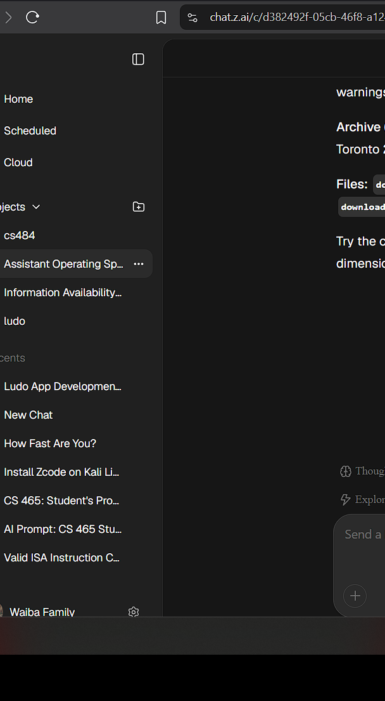
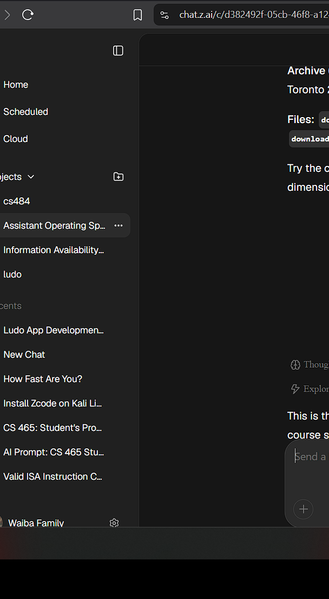

<div align="center">
  
  <h1 align="center">HUMAN Typer</h1>
  <p>A Python tool that types text into any active window (VMs, Citrix, Docs, etc.) simulating realistic human typing behavior.</p>
  <p><em>Paste blocked? Type it in.</em></p>
</div>

---

## Features

- **Human-like Typing** — random intervals, pauses after punctuation, faster common bigrams, occasional "thinking" micro-pauses.
- **Realistic Typos** — makes QWERTY-adjacent mistakes, double strikes, and transpositions, then backspaces and corrects them. The final output is always 100% correct.
- **Full Unicode on Windows** — accents, Devanagari, CJK, and even emoji are typed natively via `SendInput` (pyautogui alone can only type ASCII).
- **Anti-Double Indent ("Smart Mode")** — skips line-leading whitespace when pasting code into IDEs (VS Code, IntelliJ) to prevent staircase indentation.
- **Pause / Resume / Stop** — pause a long session mid-typing, resume exactly where it left off, or abort instantly. The mouse-corner failsafe still works as a panic stop.
- **Global Hotkeys (Windows)** — bind a Start and a Panic-Stop combo (e.g. `ctrl+q`) in Settings; they work even when the target window has focus, and the stop combo is suppressed so the target app never sees it. On macOS/Linux the in-app buttons are the controls (global hooks crash macOS).
- **Typing Styles** — Chill (more typos and pauses), Natural, Focused, and Surgeon (zero typos, machine-steady) profiles, plus organic WPM drift, word stutters, and thinking hesitations.
- **Live Session Stats** — word/character count, estimated duration, typing progress (%), and a pulsing live indicator.
- **Up to 700 WPM** — above 180 WPM the cadence switches to steady fast-mode jitter so the speed setting is real, not eaten by thinking pauses.
- **Fully Customizable Appearance** — five accent colors (Lime, Sky, Amber, Rose, Violet), three corner styles (Sharp / Soft / Round), and Light/Dark themes, all switchable live from the Settings dialog and remembered between launches.
- **Polished Settings Dialog** — a proper modal with Appearance, Typing (start delay), and reset-to-defaults, replacing the old cramped hidden row.
- **Micro-animations** — eased hover and press effects on buttons, smooth tweened progress bar, pulsing status dot, and a subtle window fade-in.
- **Crisp Vector Icons** — play/pause/stop/gear/theme icons are drawn with PIL at 4x resolution and downsampled (no emoji, no font weirdness, HiDPI-safe).

## Screenshots

| Light — Natural Flow | Dark — Forest Mode |
|---|---|
|  |  |

---

## Quick Start

### Windows
1. Install [Python](https://www.python.org/downloads/) (check **"Add to PATH"** during install).
2. Double-click **`run_gui.bat`** — dependencies install automatically on first run.

### macOS / Linux
1. Open Terminal and run:
   ```bash
   bash run_gui.sh
   ```
2. On macOS, grant **Accessibility** permission when prompted:
   `System Settings > Privacy & Security > Accessibility` → add Terminal (or your Python).

### Manual install
```bash
pip install -r requirements.txt
python human_typer_gui.py
```

> **Linux users**: you may also need `sudo apt install python3-tk python3-xdotool scrot` for pyautogui.

---

## Usage

1. **Launch the app** and paste your text into the input box (the placeholder clears itself automatically).
2. **Configure**:
   - **Flow Speed** — words per minute (30–700; above 180 uses steady fast-mode cadence).
   - **Natural Variation** — typo probability (0–20%).
   - **Anti-Double Indent (Smart Mode)** — enable when pasting code into an IDE.
   - **Settings** (gear icon) — theme, accent color, corner style, typing style, start delay, and Windows hotkey bindings.
3. **START SESSION**, then click on the target window — you get a countdown (3/5/10 s, configurable).
4. **PAUSE** suspends typing anywhere mid-session; **STOP** aborts immediately.

### CLI (no GUI)

```bash
python human_typer.py                        # interactive mode (Enter twice to start)
python human_typer.py -f essay.txt           # type a file
python human_typer.py -t "Hello world"       # type a string
python human_typer.py -f code.py --wpm 80 --error-rate 0.08 --delay 5
```

| Option | Range | Default |
|---|---|---|
| `--wpm` | 1–500 | 60 |
| `--error-rate` | 0.0–1.0 | 0.06 |
| `--delay` | seconds | 3 |

---

## Platform notes & limitations

| Platform | ASCII | Unicode (accents, Devanagari, CJK, emoji) | Notes |
|---|---|---|---|
| Windows | ✅ | ✅ native `SendInput` | |
| macOS | ✅ | ⚠️ skipped with a warning | needs Accessibility permission |
| Linux (X11) | ✅ | ⚠️ skipped with a warning | |

On platforms where a character can't be typed, the GUI shows exactly which
characters will be skipped **before** you start, and the completion status
reports how many were skipped.

---

## Troubleshooting

- **macOS: nothing types** → `System Settings > Privacy & Security > Accessibility`, allow Terminal/Python.
- **"Staircase" indentation when pasting code** → enable **Anti-Double Indent**.
- **Typing stopped by itself** → you probably hit the pyautogui failsafe (mouse in a screen corner). The status will show "Aborted (mouse corner)".
- **Exe has no window icon** → fixed in v2.1.0; rebuild with `pyinstaller HumanTyper.spec --noconfirm`.
- **Want a different look?** → Settings (gear icon): pick an accent color, corner style, and theme — everything applies live and is remembered.

---

## Responsible use

This tool simulates human typing for **your own text** in environments where clipboard paste is blocked (VMs, Citrix, remote desktops), for accessibility, and for UI testing. Typing into systems to evade bot detection, circumvent security controls, or violate terms of service of any platform is not a sanctioned use of this software.

---

## Development

```bash
# Lint
python -m pyflakes human_typer.py human_typer_gui.py create_icon.py

# Tests (engine is fully stubbed - no real keystrokes are sent)
python tests/test_engine.py
python tests/test_gui.py        # needs a display; still sends no keystrokes

# Build
pyinstaller HumanTyper.spec --noconfirm          # Windows exe
bash build_mac.sh                                # macOS .app (+ optional .dmg)
CREATE_DMG=1 bash build_mac.sh                   # non-interactive DMG
```

CI runs lint + engine tests on Ubuntu, Windows, and macOS on every push (`.github/workflows/ci.yml`). Tag builds (`v*`) produce a macOS .app artifact, with optional Developer ID signing + notarization when secrets are configured (`.github/workflows/macos_release.yml`).

See [QA_REPORT.md](QA_REPORT.md) for the full audit this release addresses and [CHANGELOG.md](CHANGELOG.md) for what changed.

## License

[MIT](LICENSE) © Prafula Tamang
